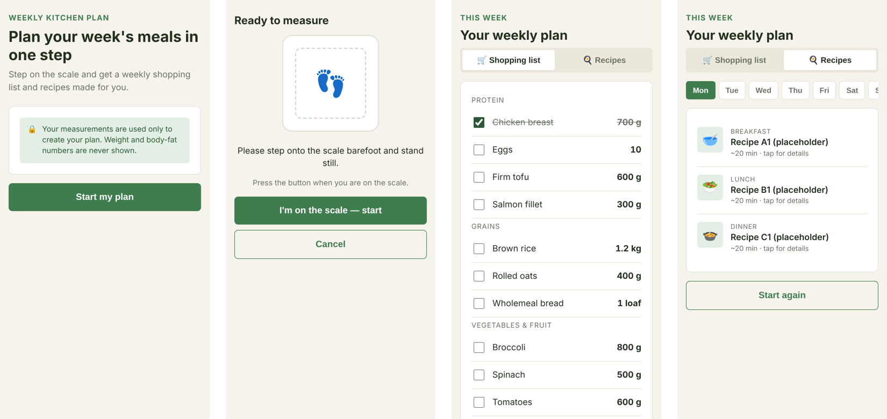

## Research Question, Plan, and Conclusions

### Why this system

Many who try to manage their weight rely on scales and tracking apps that put numbers at the centre: weight, body-fat percentage, calories. From my own experience of managing my diet, seeing these numbers often made me anxious instead of helping me decide what to eat. Research supports this concern. Frequent self-weighing has been associated with poorer psychological well-being in young women [4], food journaling apps create logging burden and "negative nudges" that discourage continued use [3], and weight-loss apps that foreground numbers can reinforce harmful behaviour in vulnerable users [5]. What students need is less self-scrutiny and more help turning their goals into concrete actions: what to buy and what to cook this week.

This project addresses UN Sustainable Development Goal 3, target 3.4, which aims to prevent non-communicable diseases and to promote mental health and well-being [6]. My prototype pairs a body-fat scale with a companion app. The scale's measurements are used only in the background; the user sees a weekly shopping list with ingredient quantities and a set of recipes, never their weight or body-fat numbers.

### Research question

How usable is a body-fat scale and companion app that turns body measurements into weekly ingredient quantities and recipes, without displaying weight or body-fat numbers, and how well does it support students' meal planning?

### Study plan

I ran an in-person evaluation with four COMP3900/6390 classmates. Each participant completed one task: start a plan, step on the scale, then use the app to review the weekly shopping list and browse the recipes. The prototype used simulated body data, so no participant's real weight or body fat was measured, displayed or stored. This was a deliberate ethical choice, to avoid causing the anxiety the system is designed to reduce.

After the task, participants completed a Google Form with three parts:

- the System Usability Scale (SUS) [1], ten 5-point items measuring perceived usability;
- five custom 5-point Likert items: three on planning support (P1-P3: whether the quantities help decide what to buy, whether the plan can be turned into shopping and cooking, and whether the recipes fit everyday habits) and two on the no-numbers design (C1: comfort without seeing body numbers; C2: trust in the recommendations without seeing body data);
- two open questions on what was most and least helpful for planning meals, and how it felt not to see body numbers.

I also took observation notes during each session and photographed participants' hands using the prototype.

### Analysis framework

SUS scores were calculated with the standard scoring method and compared with the commonly cited average of 68 [2]. With only four participants, I report descriptive statistics (median and range) for the custom items instead of inferential tests. Open answers and observation notes were coded inductively into a small number of themes, which I use to explain the quantitative results, especially any tension between comfort (C1) and trust (C2).

Participants gave consent on the first page of the form. Names and uids were collected only to verify participation and were removed from the exported data in the `materials` folder.

### Conclusions

<!-- TODO: write after analysis (2-3 sentences answering the RQ). -->

## Prototype Design and Features

The prototype has two parts: a body-fat scale as the physical input, and a mobile web app (<https://04d-4711.github.io/COMP6390A3/Prototype.html>) that participants use on a phone placed next to the scale.

<!-- TODO: add images

-->

### Interaction flow

1. **Home.** A "Start my plan" button and a short note that weight and body-fat numbers are never shown.
2. **Confirm.** The app asks the user to step onto the scale barefoot and press start once they are standing still.
3. **Measuring.** A short progress animation with status messages ("Analysing...", "Creating your weekly plan...").
4. **Plan ready.** A confirmation screen that tells the user they can step off. No measurements are displayed.
5. **Weekly plan.** Two tabs. The *Shopping list* groups ingredients (protein, grains, vegetables and fruit, dairy and other) with weekly quantities, such as 700 g of chicken breast, and each item can be ticked off while shopping. The *Recipes* tab shows breakfast, lunch and dinner for each day from Monday to Sunday, and each meal opens a recipe page with ingredients and steps.

A "Start again" button resets the app for the next participant.

### Non-standard interaction

The main input is the user's body. Standing on the scale replaces typing in weight, body fat or goals, and the output is a plan for action instead of a set of numbers. In the full design, the app would combine the scale reading with the user's height, entered once, to calculate the weekly plan.

### How it meets user needs

- **Hiding the numbers** keeps the focus on what to do next instead of on self-evaluation, responding to the risks of number-centred self-monitoring [4, 5].
- **Ingredient quantities instead of calorie logging** remove the burden of recording every meal, a common barrier in food journaling [3], and connect body data directly to a concrete shopping decision.
- **The tick-off shopping list and day-by-day recipes** support the step from planning to doing, which the custom items P1 and P2 measure.

### Fidelity and limitations

The prototype works in a Wizard-of-Oz style: scale readings are simulated, every participant receives the same plan, and the recipes are placeholders. It can therefore test whether the flow is understandable and whether the plan format supports meal planning, but not measurement accuracy, the quality of personalisation, or long-term changes in eating behaviour.

## Research Data, Analysis and Findings

<!--
Fill after the study:
- SUS: per-participant scores table + mean; compare with 68 benchmark [2]
- P1–P3, C1–C2: medians/ranges table or a small plot (materials/likert.png)
- Open answers: 2–3 themes with short quotes (P1, P2...)
- Observations: hesitations, questions asked, where people got stuck
- Link every finding back to the RQ (usability + planning support + no-numbers design)
- Data files: materials/survey_responses.csv (names/uids removed), materials/analysis.py
-->

## Positionality Statement (COMP6390 only)

<!--
Must also appear in the video. Base it on your in-class draft, rewritten in your own words:
- you are managing your own diet → user's perspective, may expect others to value the same things
- decision: suggestions instead of body numbers; simulated data instead of a real scale reading
- consequence: can assess perceived usability, NOT sensing accuracy or long-term behaviour change
- recruiting COMP6390 classmates → shared background, may give favourable ratings
- what you will do about it: report critical feedback explicitly, separate your interpretation from data
-->

## Participants

- u7861824 Ruojin Li
- u8207906 Qifeng He
- u8168849 Fan Yang
- u8210662 Jie Ren

## Acknowledgements

<!-- Fill in the "I ..." part of each line truthfully; add/remove lines as needed. -->

- Positionality statement (in-class draft): Claude (Anthropic) drafted wording from my description of my background and design decisions; I ...
- Research question: Claude combined my answers to the four-step RQ framework into candidate wordings; I chose and edited ...
- Questionnaire: Claude drafted the wording of the custom items P1–P3 and C1–C2 and wrote the Google Apps Script `materials/create_survey_form.gs` that builds the Google Form; I specified the constructs, edited the items, and checked the form. SUS items are the standard scale [1].
- Prototype: Claude wrote the HTML/CSS/JavaScript of `Prototype.html` from my description of the interaction flow; I specified the flow and the no-numbers design, tested it, and deployed it on GitHub Pages.
- References: Claude suggested candidate references and checked their details; I read and verified each source.

## References

1. John Brooke. 1996. SUS: A "quick and dirty" usability scale. In *Usability Evaluation in Industry*, Patrick W. Jordan, Bruce Thomas, Bernard A. Weerdmeester, and Ian L. McClelland (Eds.). Taylor & Francis, London, 189-194. <https://doi.org/10.1201/9781498710411-35>
2. Aaron Bangor, Philip T. Kortum, and James T. Miller. 2008. An empirical evaluation of the System Usability Scale. *International Journal of Human-Computer Interaction* 24, 6 (2008), 574-594. <https://doi.org/10.1080/10447310802205776>
3. Felicia Cordeiro, Daniel A. Epstein, Edison Thomaz, Elizabeth Bales, Arvind K. Jagannathan, Gregory D. Abowd, and James Fogarty. 2015. Barriers and negative nudges: Exploring challenges in food journaling. In *Proceedings of the 33rd Annual ACM Conference on Human Factors in Computing Systems* (CHI '15), 1159-1168. <https://doi.org/10.1145/2702123.2702155>
4. Carly R. Pacanowski, Katie A. Loth, Peter J. Hannan, Jennifer A. Linde, and Dianne R. Neumark-Sztainer. 2015. Self-weighing throughout adolescence and young adulthood: Implications for well-being. *Journal of Nutrition Education and Behavior* 47, 6 (2015), 506-515. <https://doi.org/10.1016/j.jneb.2015.08.009>
5. Elizabeth V. Eikey and Madhu C. Reddy. 2017. "It's definitely been a journey": A qualitative study on how women with eating disorders use weight loss apps. In *Proceedings of the 2017 CHI Conference on Human Factors in Computing Systems* (CHI '17), 642-654. <https://doi.org/10.1145/3025453.3025591>
6. United Nations. 2015. Goal 3: Ensure healthy lives and promote well-being for all at all ages. Retrieved November 3, 2026 from <https://sdgs.un.org/goals/goal3>