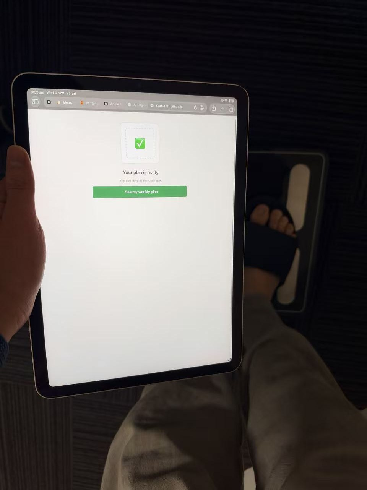

<!--
TODO before submission: delete ALL comments in this file (the template asks for it).
Word budget (max 1980 total): RQ ~550 · Prototype ~400 · Findings ~650 · Positionality ~200
-->

## Research Question, Plan, and Conclusions

<!--
Write in your own words. Points to cover (from your decisions so far):

### Motivation
- Area: healthy eating / diet management for university students
- Problem: seeing weight and body-fat numbers while managing weight can cause anxiety;
  you want a system that focuses on ACTION (what to buy, what to cook), not self-scrutiny
- Justification: your own experience + literature:
  - frequent self-weighing linked to poorer psychological outcomes in young women [4]
  - food tracking/journaling apps create burden and negative nudges [3]
  - weight-loss apps that foreground numbers can harm vulnerable users [5]
- SDG 3, target 3.4 (prevent non-communicable disease + promote mental health and well-being) [6]

### Research question (version A, edit if needed)
How usable is a body-fat scale and companion app that turns body measurements into weekly
ingredient quantities and recipes, without displaying weight or body-fat numbers, and how
well does it support students' meal planning?

### Study plan
- Participants: 4 COMP3900/6390 classmates, in person
- Task: step on scale → start plan → read shopping list → browse recipes
- Prototype uses SIMULATED body data; no real measurement shown or stored (say why: participant anxiety/privacy)
- Data: SUS (10 items) [1]; 5 custom Likert items (P1–P3 planning support, C1–C2 comfort/trust
  without numbers); 2 open questions; photos of hands + device; your observation notes
- Analysis: SUS scoring and benchmark ~68 [2]; descriptive stats (median/range, no inferential tests, n=4);
  short thematic coding of open answers
- Ethics: consent page, name/uid removed from exported CSV, photos without faces

### Conclusions
- (write AFTER analysis: 2–3 sentences answering the RQ)
-->

## Prototype Design and Features

<!--
Points to cover:
- Physical part: body-fat scale (what it physically is in your setup)
- App (web prototype on phone, link: https://04d-4711.github.io/COMP6390A3/Prototype.html):
  1. Home: "Start my plan" + privacy note (numbers never shown)
  2. Confirm: step on scale, press start
  3. Measuring animation (simulated ~3 s)
  4. "Your plan is ready" — no numbers
  5. Weekly plan: Shopping list (fixed quantities, tick-off) + Recipes by day (placeholder recipes)
- Non-standard interaction: standing on the scale is the input; no typing of personal data
- Design rationale: hide numbers → focus on action; quantities link body data to shopping
- Fidelity limits: fixed plan for everyone, placeholder recipes, Wizard-of-Oz style measurement
- Insert images:
  
  
-->

## Research Data, Analysis and Findings

<!--
Fill after the study:
- SUS: per-participant scores table + mean; compare with 68 benchmark [2]
- P1–P3, C1–C2: medians/ranges table or a small plot (materials/likert.png)
- Open answers: 2–3 themes with short quotes (P1, P2...)
- Observations: hesitations, questions asked, where people got stuck
- Link every finding back to the RQ (usability + planning support + no-numbers design)
- Data files: materials/survey_responses.csv (names/uids removed), materials/analysis.py
-->

## Positionality Statement (COMP6390 only)

<!--
Must also appear in the video. Base it on your in-class draft, rewritten in your own words:
- you are managing your own diet → user's perspective, may expect others to value the same things
- decision: suggestions instead of body numbers; simulated data instead of a real scale reading
- consequence: can assess perceived usability, NOT sensing accuracy or long-term behaviour change
- recruiting COMP6390 classmates → shared background, may give favourable ratings
- what you will do about it: report critical feedback explicitly, separate your interpretation from data
-->

## Participants

- u7861824 Ruojin Li
- u8207906 Qifeng He
- u8168849 Fan Yang
- u8210662 Jie Ren

## Acknowledgements

<!-- Fill in the "I ..." part of each line truthfully; add/remove lines as needed. -->

- Positionality statement (in-class draft): Claude (Anthropic) drafted wording from my description of my background and design decisions; I ...
- Research question: Claude combined my answers to the four-step RQ framework into candidate wordings; I chose and edited ...
- Questionnaire: Claude drafted the wording of the custom items P1–P3 and C1–C2 and wrote the Google Apps Script `materials/create_survey_form.gs` that builds the Google Form; I specified the constructs, edited the items, and checked the form. SUS items are the standard scale [1].
- Prototype: Claude wrote the HTML/CSS/JavaScript of `Prototype.html` from my description of the interaction flow; I specified the flow and the no-numbers design, tested it, and deployed it on GitHub Pages.
- References: Claude suggested candidate references and checked their details; I read and verified each source.

## References

1. John Brooke. 1996. SUS: A "quick and dirty" usability scale. In *Usability Evaluation in Industry*, Patrick W. Jordan, Bruce Thomas, Bernard A. Weerdmeester, and Ian L. McClelland (Eds.). Taylor & Francis, London, 189-194. <https://doi.org/10.1201/9781498710411-35>
2. Aaron Bangor, Philip T. Kortum, and James T. Miller. 2008. An empirical evaluation of the System Usability Scale. *International Journal of Human-Computer Interaction* 24, 6 (2008), 574-594. <https://doi.org/10.1080/10447310802205776>
3. Felicia Cordeiro, Daniel A. Epstein, Edison Thomaz, Elizabeth Bales, Arvind K. Jagannathan, Gregory D. Abowd, and James Fogarty. 2015. Barriers and negative nudges: Exploring challenges in food journaling. In *Proceedings of the 33rd Annual ACM Conference on Human Factors in Computing Systems* (CHI '15), 1159-1168. <https://doi.org/10.1145/2702123.2702155>
4. Carly R. Pacanowski, Katie A. Loth, Peter J. Hannan, Jennifer A. Linde, and Dianne R. Neumark-Sztainer. 2015. Self-weighing throughout adolescence and young adulthood: Implications for well-being. *Journal of Nutrition Education and Behavior* 47, 6 (2015), 506-515. <https://doi.org/10.1016/j.jneb.2015.08.009>
5. Elizabeth V. Eikey and Madhu C. Reddy. 2017. "It's definitely been a journey": A qualitative study on how women with eating disorders use weight loss apps. In *Proceedings of the 2017 CHI Conference on Human Factors in Computing Systems* (CHI '17), 642-654. <https://doi.org/10.1145/3025453.3025591>
6. United Nations. 2015. Goal 3: Ensure healthy lives and promote well-being for all at all ages. Retrieved November 3, 2026 from <https://sdgs.un.org/goals/goal3>