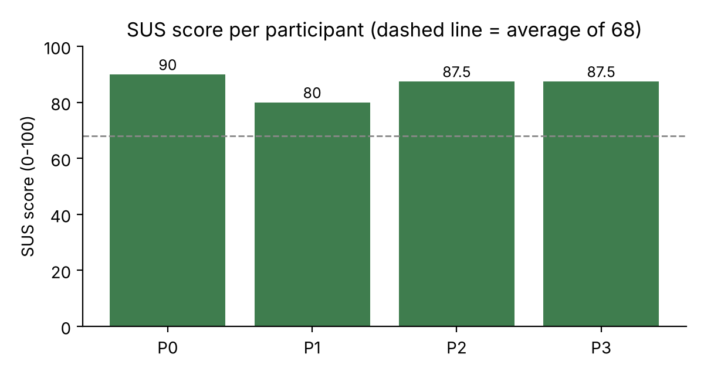
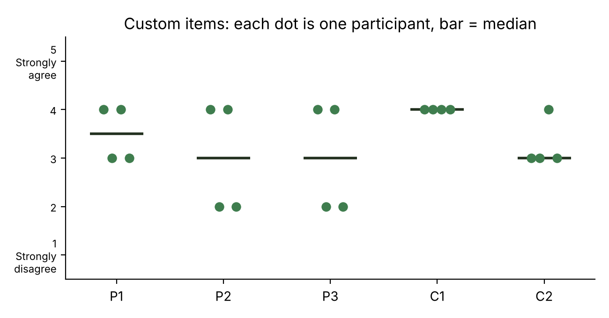

## Research Question, Plan, and Conclusions

### Why this system

Many who try to manage their weight rely on scales and tracking apps that put numbers at the centre: weight, body-fat percentage, calories. From my own experience of managing my diet, seeing these numbers often made me anxious instead of helping me decide what to eat. Research supports this concern. Frequent self-weighing has been associated with poorer psychological well-being in young women [4], food journaling apps create logging burden and "negative nudges" that discourage continued use [3], and weight-loss apps that foreground numbers can reinforce harmful behaviour in vulnerable users [5]. What students need is less self-scrutiny and more help turning their goals into concrete actions: what to buy and what to cook this week.

This project addresses UN Sustainable Development Goal 3, target 3.4, which aims to prevent non-communicable diseases and to promote mental health and well-being [6]. My prototype pairs a body-fat scale with a companion app. The scale's measurements are used only in the background; the user sees a weekly shopping list with ingredient quantities and a set of recipes, never their weight or body-fat numbers.

### Research question

How usable is a body-fat scale and companion app that turns body measurements into weekly ingredient quantities and recipes, without displaying weight or body-fat numbers, and how well does it support students' meal planning?

### Research plan

I ran an in-person evaluation with four COMP3900/6390 classmates. Each participant completed one task: start a plan, step on the scale, then use the app to review the weekly shopping list and browse the recipes. The prototype used simulated body data, so no participant's real weight or body fat was measured, displayed or stored. This was a deliberate ethical choice, to avoid causing the anxiety the system is designed to reduce.

After the task, participants completed a Google Form with three parts:

- the System Usability Scale (SUS) [1], ten 5-point items measuring perceived usability;
- five custom 5-point Likert items: three on planning support (P1-P3: whether the quantities help decide what to buy, whether the plan can be turned into shopping and cooking, and whether the recipes fit everyday habits) and two on the no-numbers design (C1: comfort without seeing body numbers; C2: trust in the recommendations without seeing body data);
- two open questions on what was most and least helpful for planning meals, and how it felt not to see body numbers.

I also took observation notes during each session and photographed participants' hands using the prototype.

### Analysis framework

SUS scores were calculated with the standard scoring method and compared with the commonly cited average of 68 [2]. With only four participants, I report descriptive statistics (median and range) for the custom items instead of inferential tests. Open answers and observation notes were coded inductively into a small number of themes, which I use to explain the quantitative results, especially any tension between comfort (C1) and trust (C2).

Participants gave consent on the first page of the form. Names and uids were collected only to verify participation and were removed from the exported data in the `materials` folder.

### Conclusions

The prototype was highly usable (mean SUS 86.25), and hiding weight and body-fat numbers made every participant comfortable. Its support for meal planning was mixed: the automatic shopping list was valued, but a fixed plan that cannot be personalised limited whether participants could turn it into real shopping and cooking. Hiding numbers also did not build trust on its own. The next iteration should let users swap ingredients and set preferences, and explain each plan with meal-level nutrition information instead of body numbers. These findings come from four classmates in a single short session with a fixed plan, so they show perceived usability and acceptance, not long-term changes in eating behaviour.

## Prototype Design and Features

The prototype has two parts: a body-fat scale as the physical input, and a mobile web app (<https://04d-4711.github.io/COMP6390A3/Prototype.html>) that participants use on a phone placed next to the scale.

<!-- TODO: add images

-->

### Interaction flow

1. **Home.** A "Start my plan" button and a short note that weight and body-fat numbers are never shown.
2. **Confirm.** The app asks the user to step onto the scale barefoot and press start once they are standing still.
3. **Measuring.** A short progress animation with status messages ("Analysing...", "Creating your weekly plan...").
4. **Plan ready.** A confirmation screen that tells the user they can step off. No measurements are displayed.
5. **Weekly plan.** Two tabs. The *Shopping list* groups ingredients (protein, grains, vegetables and fruit, dairy and other) with weekly quantities, such as 700 g of chicken breast, and each item can be ticked off while shopping. The *Recipes* tab shows breakfast, lunch and dinner for each day from Monday to Sunday, and each meal opens a recipe page with ingredients and steps.

A "Start again" button resets the app for the next participant.

### Non-standard interaction

The main input is the user's body. Standing on the scale replaces typing in weight, body fat or goals, and the output is a plan for action instead of a set of numbers. In the full design, the app would combine the scale reading with the user's height, entered once, to calculate the weekly plan.

### How it meets user needs

- **Hiding the numbers** keeps the focus on what to do next instead of on self-evaluation, responding to the risks of number-centred self-monitoring [4, 5].
- **Ingredient quantities instead of calorie logging** remove the burden of recording every meal, a common barrier in food journaling [3], and connect body data directly to a concrete shopping decision.
- **The tick-off shopping list and day-by-day recipes** support the step from planning to doing, which the custom items P1 and P2 measure.

### Fidelity and limitations

The prototype works in a Wizard-of-Oz style: scale readings are simulated, every participant receives the same plan, and the recipes are placeholders. It can therefore test whether the flow is understandable and whether the plan format supports meal planning, but not measurement accuracy, the quality of personalisation, or long-term changes in eating behaviour.

## Research Data, Analysis and Findings

Four participants (P0-P3) completed the task and the questionnaire. Raw responses are in `materials/survey_responses.csv`, and all numbers below are produced by `materials/analysis.py`. To avoid confusion with participant codes, questionnaire items are always written as "item P1", "item C2", and so on.

### Usability: SUS

| Participant | P0 | P1 | P2 | P3 | Mean |
| --- | --- | --- | --- | --- | --- |
| SUS score | 90 | 80 | 87.5 | 87.5 | 86.25 |

All four scores were well above the commonly cited average of 68 [2], and no participant agreed that they would need technical support or had to learn a lot before using the system (items SUS4 and SUS10 were all rated 1). The flow from "Start my plan" to the weekly plan was easy to follow. This result should be read with care: the task was short, the prototype has few screens, and participants were friendly classmates.

### Planning support: items P1-P3

| Item | Median | Responses (P0, P1, P2, P3) |
| --- | --- | --- |
| P1 quantities help decide what to buy | 3.5 | 4, 3, 4, 3 |
| P2 plan can be turned into shopping and cooking | 3 | 4, 2, 4, 2 |
| P3 recipes fit everyday eating habits | 3 | 4, 2, 4, 2 |
| C1 comfortable without seeing body numbers | 4 | 4, 4, 4, 4 |
| C2 trusted recommendations without body data | 3 | 3, 3, 4, 3 |

Planning support was clearly weaker than usability. Items P2 and P3 split the group: P0 and P2 agreed (4), while P1 and P3 disagreed (2). The open answers explain this split. The shopping list was the most valued feature:

> "The automatic shopping list, because it saves me a lot of time." (P2)
>
> "I don't need to think what I should eat today." (P0)

However, every participant named a lack of personalisation as the least helpful part:

> "Not really fit personal preference :)" (P3)
>
> "It doesn't let me swap out ingredients I don't like or customize the meals." (P2)

The two participants who disagreed with items P2 and P3 were the two whose comments focused only on this problem. Part of this result comes from the prototype's fidelity, since everyone received the same fixed plan and placeholder recipes, but it also shows that a plan users cannot adjust is hard to turn into real shopping and cooking.

### The no-numbers design: items C1 and C2

All four participants agreed that they felt comfortable without seeing their weight or body-fat numbers (item C1 = 4 for everyone). Three participants described this positively ("It was refreshing and reduced my tracking anxiety", P1; "Good, I don't want to know", P3). P0 was the exception: hiding the numbers did "not have big influence on me, because I have my own body data recorded on Apple Health and check every day."

Trust was lower than comfort. Three of four participants were neutral on item C2, so hiding body data made the system comfortable but did not by itself make the recommendations convincing. P0's suggestion points to a possible solution: "show percentage of different kinds of nutrition in each meal". This would explain why a plan was recommended without showing the user's body numbers.

### Themes from open answers

| Theme | Participants |
| --- | --- |
| The automatic shopping list removes daily decisions and saves time | P0, P1, P2 |
| Plans and recipes cannot be personalised or substituted | P0, P1, P2, P3 |
| Not seeing numbers feels private or relieving | P1, P2, P3 |
| Users who already track their body data are indifferent to hiding it | P0 |
| Users want to know why a plan is recommended (nutrition information) | P0 |

<!-- TODO: add 2-3 sentences from YOUR observation notes (hesitations, questions participants asked, where they tapped first), and the photo of a participant using the prototype. Only write what you actually observed. -->

## Positionality Statement (COMP6390 only)

Because I am managing my own diet, I designed this system from a user's perspective, and my own discomfort with seeing weight and body-fat numbers led me to hide them and show only ingredient quantities and recipes. This means my study can explore whether a no-numbers design feels comfortable and useful, but it also builds my own value into the product: some people are motivated by numbers, and my design may not suit them. Because I cook for myself, I assumed that users have a kitchen and time to cook, so the plan is built around weekly shopping and home cooking; the study cannot tell me how the system would work for students who mostly eat out or live without cooking facilities. Because my background is in supply chain planning and demand forecasting, I framed healthy eating as a planning problem, turning body data into weekly quantities to buy, and chose questionnaire items about planning support rather than emotions or habits. Finally, my participants are classmates who also took part in my earlier study, and I operated the simulated prototype myself, so they may have rated it more favourably than other users would.

<!-- TODO: add 1-2 sentences in YOUR words about how your position shaped how you read the data. Candidate moments from your actual data:
- C1 = 4 for everyone looked like confirmation of your design, but P0 said hiding numbers made no difference because they check Apple Health every day; your discomfort with numbers is not shared by everyone.
- C2 was neutral for 3/4: comfort did not equal trust, which goes against your expectation that hiding numbers would simply be better.
- Every participant asked for personalisation: as someone who cooks for yourself, you designed one fixed plan around your own way of shopping and cooking.
Write what YOU actually thought when you saw these results, and what you did about it (e.g., reported P0's view and the C2 result instead of treating them as noise). -->

## Participants

- u7861824 Ruojin Li
- u8207906 Qifeng He
- u8168849 Fan Yang
- u8210662 Jie Ren

## Acknowledgements

<!-- Fill in the "I ..." part of each line truthfully; add/remove lines as needed. -->

- Positionality statement (in-class draft): Claude (Anthropic) drafted wording from my description of my background and design decisions; I ...
- Research question: Claude combined my answers to the four-step RQ framework into candidate wordings; I chose and edited ...
- Questionnaire: Claude drafted the wording of the custom items P1–P3 and C1–C2 and wrote the Google Apps Script `materials/create_survey_form.gs` that builds the Google Form; I specified the constructs, edited the items, and checked the form. SUS items are the standard scale [1].
- Prototype: Claude wrote the HTML/CSS/JavaScript of `Prototype.html` from my description of the interaction flow; I specified the flow and the no-numbers design, tested it, and deployed it on GitHub Pages.
- References: Claude suggested candidate references and checked their details; I read and verified each source.
- Report text: Claude drafted the text of the sections "Research Question, Plan, and Conclusions", "Prototype Design and Features", "Research Data, Analysis and Findings" and "Positionality Statement" from my decisions, my data and our discussion; I ...
- Analysis: Claude wrote `materials/analysis.py` (SUS scoring, Likert summaries and the two figures) and suggested the themes from the open answers; I checked the scores against the raw CSV in `materials/survey_responses.csv` and ...

## References

1. John Brooke. 1996. SUS: A "quick and dirty" usability scale. In *Usability Evaluation in Industry*, Patrick W. Jordan, Bruce Thomas, Bernard A. Weerdmeester, and Ian L. McClelland (Eds.). Taylor & Francis, London, 189-194. <https://doi.org/10.1201/9781498710411-35>
2. Aaron Bangor, Philip T. Kortum, and James T. Miller. 2008. An empirical evaluation of the System Usability Scale. *International Journal of Human-Computer Interaction* 24, 6 (2008), 574-594. <https://doi.org/10.1080/10447310802205776>
3. Felicia Cordeiro, Daniel A. Epstein, Edison Thomaz, Elizabeth Bales, Arvind K. Jagannathan, Gregory D. Abowd, and James Fogarty. 2015. Barriers and negative nudges: Exploring challenges in food journaling. In *Proceedings of the 33rd Annual ACM Conference on Human Factors in Computing Systems* (CHI '15), 1159-1168. <https://doi.org/10.1145/2702123.2702155>
4. Carly R. Pacanowski, Katie A. Loth, Peter J. Hannan, Jennifer A. Linde, and Dianne R. Neumark-Sztainer. 2015. Self-weighing throughout adolescence and young adulthood: Implications for well-being. *Journal of Nutrition Education and Behavior* 47, 6 (2015), 506-515. <https://doi.org/10.1016/j.jneb.2015.08.009>
5. Elizabeth V. Eikey and Madhu C. Reddy. 2017. "It's definitely been a journey": A qualitative study on how women with eating disorders use weight loss apps. In *Proceedings of the 2017 CHI Conference on Human Factors in Computing Systems* (CHI '17), 642-654. <https://doi.org/10.1145/3025453.3025591>
6. United Nations. 2015. Goal 3: Ensure healthy lives and promote well-being for all at all ages. Retrieved November 3, 2026 from <https://sdgs.un.org/goals/goal3>